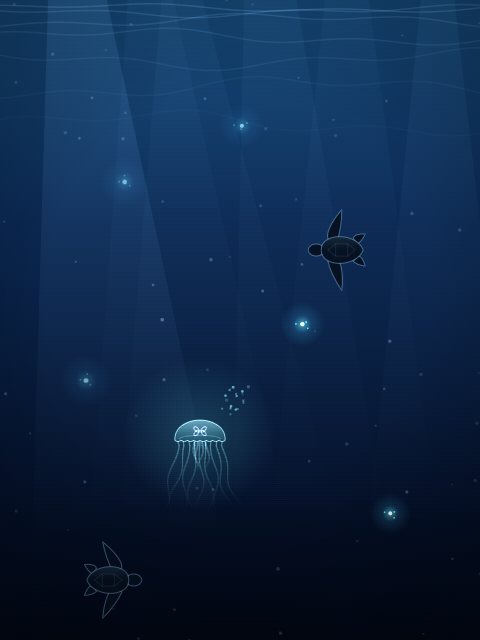
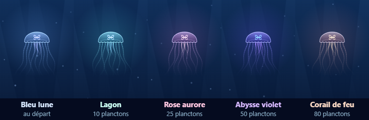
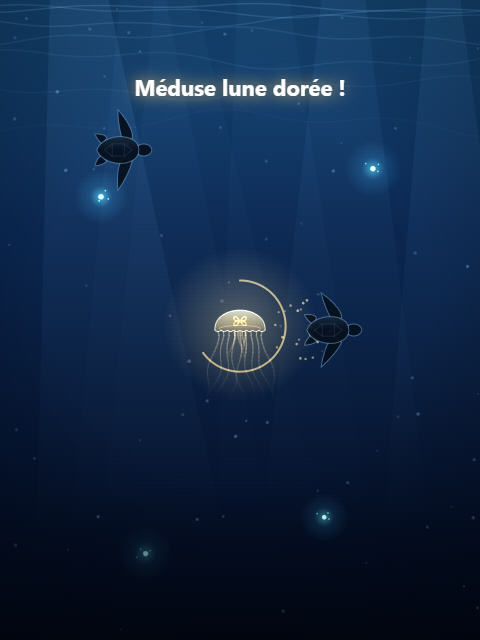

# 🪼 Méduses
**[Jouer en ligne](https://nihirii.github.io/Jellyfish/)**
Un petit jeu d'arcade dans le navigateur : tu guides une méduse dans les profondeurs, tu manges du plancton lumineux et tu évites les tortues de mer qui traversent l'écran.

HTML, CSS et JavaScript vanilla avec `<canvas>`. Pas de dépendance, pas de build. Ça se joue sur ordinateur comme sur mobile.

<p align="center">
  
</p>

## Jouer

Ouvre `index.html` dans un navigateur, ou lance un petit serveur local :

```bash
npx serve .
```

## Commandes

| Action | Commande |
| --- | --- |
| Déplacer la méduse | Souris, doigt ou flèches du clavier |
| Lancer une partie | Bouton **Jouer** |

## Règles

- Chaque plancton mangé rapporte 1 point.
- Une tortue qui touche la méduse termine la partie.
- Plus la partie dure, plus les tortues sont rapides et nombreuses.
- Le meilleur score est gardé dans le `localStorage` du navigateur.

## Couleurs de la méduse

Plus ta méduse mange, plus elle change de couleur. Chaque nouveau palier s'annonce à l'écran, et la couleur atteinte est rappelée en fin de partie.



## Un secret dans les profondeurs…

<details>
<summary>Attention, ça divulgâche l'easter egg</summary>

<br />

Pendant une partie, tape **`lune`** au clavier, ou touche **5 fois** la méduse en moins de 2 secondes.

Ta méduse devient alors une **méduse lune dorée** pendant 10 secondes :

- les tortues qui la touchent sont repoussées et s'enfuient ;
- chaque plancton rapporte 2 points ;
- un anneau doré autour d'elle montre le temps restant.

Ça ne marche qu'une fois par partie.

<p align="center">
  
</p>

</details>

## Structure

```
meduses/
├── index.html     # page et écran d'accueil
├── style.css      # mise en page et thème
├── game.js        # boucle de jeu, entités, dessin et entrées
└── screenshots/   # captures utilisées dans ce README
```
